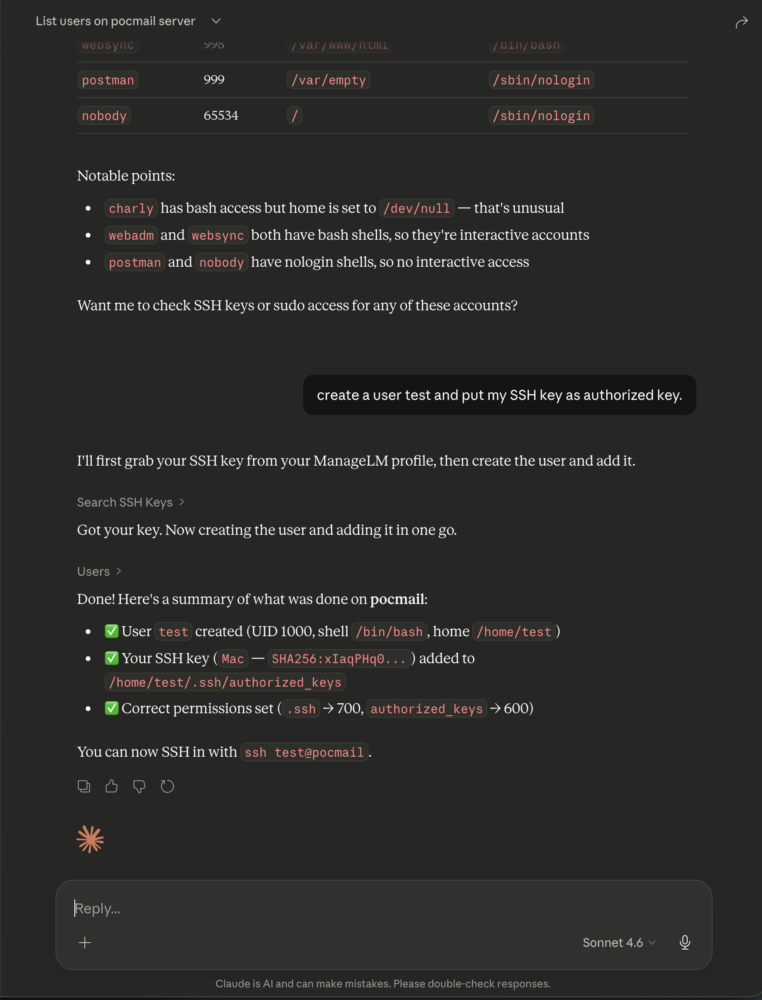
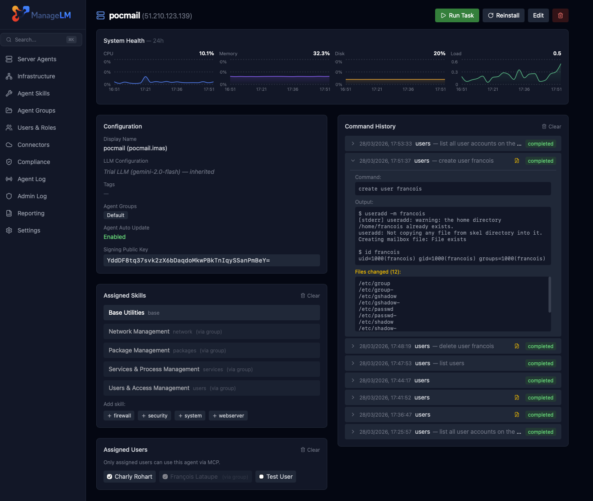

<p align="center">
  <a href="https://www.managelm.com">
    
  </a>
</p>

<h3 align="center">Claude Plugin</h3>

<p align="center">
  Manage Linux &amp; Windows servers from Claude (claude.ai, Cowork and Claude Code) using natural language.
</p>

<p align="center">
  <a href="LICENSE"></a>
  <a href="https://www.managelm.com"></a>
  <a href="https://www.managelm.com/plugins/claude.html"></a>
  <a href="https://github.com/managelm/claude-plugin/releases"></a>
</p>

<p align="center">
  
</p>

---

Ask Claude to check system status, manage packages, configure services, transfer files, run security audits, and more — across one server or an entire fleet. The plugin connects Claude to your infrastructure through MCP (Model Context Protocol), a secure cloud portal, and lightweight agents running on your servers, and adds skills that teach Claude how to use them well.

## Features

- **Natural language** — describe tasks in plain English; Claude picks the right skill and parameters
- **33 built-in skills** — packages, services, firewall, web servers, databases, containers and Kubernetes, certificates, VPN, Active Directory, and more, across Linux and Windows
- **Multi-server targeting** — run on a single server, a group, or broadcast to all agents
- **File transfers** — upload and download files (text and binary) between local and remote
- **Security audits** — run audits, search findings across your fleet, remediate issues
- **Task history & revert** — review what changed, inspect diffs, revert any task
- **Cross-infrastructure search** — find agents by health/OS, search inventory, security findings and threats, user activity, SSH keys, sudo rules, certificates, monitors, backups, scheduled tasks, credentials, keystore, and hosting resources
- **Zero inbound ports** — agents connect outbound only; no SSH, no open ports on your servers

## Quick Start

### 1. Install

The same plugin works in claude.ai (web and desktop), Cowork and Claude Code.

**claude.ai and Cowork**: add ManageLM from the plugin directory under Customize > Plugins, or choose Add > Add marketplace and enter `managelm/claude-plugin`, then install ManageLM. You can also upload the ZIP from the [latest release](https://github.com/managelm/claude-plugin/releases/latest) with Add > Upload plugin.

**Claude Code**: a plugin you add on claude.ai also loads in Claude Code when you sign in with your claude.ai account. To install it from this repository instead, run in a session (Claude Code 2.1.275 or later):

```
/plugin install managelm --marketplace managelm/claude-plugin
```

Or from your shell:

```bash
claude plugin marketplace add managelm/claude-plugin
claude plugin install managelm@managelm
```

**Without the plugin**, you can add only the MCP server, without the skills. In Claude Code:

```bash
claude mcp add --transport http managelm https://app.managelm.com/mcp
```

Or add it to a project's `.mcp.json`:

```json
{
  "mcpServers": {
    "managelm": {
      "type": "http",
      "url": "https://app.managelm.com/mcp"
    }
  }
}
```

In claude.ai, add `https://app.managelm.com/mcp` as a custom connector under Customize > Connectors.

### 2. Authenticate

ManageLM uses **OAuth 2.0 with Dynamic Client Registration** (RFC 7591). Claude registers itself as an OAuth client and opens your browser to authorize access — no client ID or secret to copy. All you need is a [ManageLM account](https://app.managelm.com/register) (free for up to 10 agents).

- **claude.ai and Cowork**: connect `managelm` from the plugin's **Connectors** tab.
- **Claude Code**: the sign-in opens on first use, or run `/mcp`, select `plugin:managelm:managelm` and authenticate.

### 3. Use it

```
> Check disk usage on web-prod-01

> Install nginx on all servers in the staging group

> Upload my local config.yml to /etc/myapp/config.yml on db-primary

> Run a security audit on all production servers

> Which servers have CPU usage above 80%?

> Create a user deploy with my SSH key on web-prod-01
```

## Plugin Skills

The plugin adds three skills on top of the ManageLM tools. Claude uses them on its own when they fit; in Claude Code you can also call them as `/managelm:<skill>`.

| Skill | What it does |
|-------|--------------|
| `manage-servers` | How to work with ManageLM: find the server first, answer questions from fleet searches, confirm risky changes, transfer files, review and revert tasks |
| `setup` | Connects ManageLM, including a self-hosted portal, and checks that it works |
| `troubleshoot` | Diagnoses sign-in, connection, offline servers, failed tasks and missing tools |

## Architecture

```
Claude ── MCP ──> ManageLM Portal ── WebSocket ──> Agent on Server
                  (cloud control      (outbound       (your LLM,
                   plane)              only)            skill exec)
```

Every task dispatched to an agent is cryptographically signed (Ed25519). Each agent calls the LLM you configure for it: with a local model, your data never leaves your infrastructure.

## Available Skills

Each skill imported into your account from the portal's catalog becomes one tool; a new account starts with `base` only. An account set to No LLM gets no skill tools.

| Skill | Description |
|-------|-------------|
| `base` | Read-only utilities — files, system info, resource usage, diagnostics (always assigned) |
| `system` | Hostname, timezone, locale, kernel modules, sysctls, bootloader |
| `packages` | Install, update, and remove packages and system updates |
| `services` | Services, processes, scheduled tasks, systemd units and timers |
| `users` | Accounts, groups, passwords, SSH keys, sudo |
| `network` | Adapters, IP addresses, routing, bridges, traffic shaping |
| `firewall` | Firewall rules, profiles, IP sets, access policies |
| `security` | fail2ban, SSH hardening, SELinux/AppArmor, auditd, antivirus |
| `files` | Read, write, upload, download files (text and binary) |
| `storage` | Disks, volumes, LVM, ZFS, Btrfs, LUKS, quotas |
| `containers` | Docker/Podman containers, Compose, Kubernetes, Helm |
| `webserver` | Web server sites, virtual hosts, HTTPS, modules |
| `database` | MySQL/MariaDB, PostgreSQL, SQLite: queries, backups, restores |
| `certificates` | SSL/TLS certificates, certificate stores, HTTPS bindings |
| `activedirectory` | Active Directory users, groups, OUs, group policies (Windows) |
| ...and more | Automation, backup, developer tools, DNS, email, file sharing, LDAP, LLM servers, logs, message queues, monitoring, NoSQL, proxy, RDP, registry, virtualization, VPN, web apps |

## Discovery & Management Tools

Beyond the skills, the portal gives Claude 32 built-in tools. A few only appear when they apply: `search_pki`, `search_monitors`, `search_backups`, `search_credentials` and `search_keystore` follow the optional features enabled on your account; the hosting tools appear once a hosting connector exists, and `cloud_action` only once a hosting connector has write mode on; on an account set to No LLM, `get_agent_skills`, `list_available_skills`, `answer_task` and `search_schedules` are hidden.

| Tool | Description |
|------|-------------|
| `search_agents` | List servers (status, OS, health, groups, site) or filter by CPU/memory/disk, OS, status, group, site |
| `get_agent_info` | Detailed info for a single server |
| `get_agent_skills` | Skills assigned to a server, and those that could be |
| `list_available_skills` | Catalog skills not yet imported into your account |
| `get_account_info` | Plan, usage limits, groups and sites |
| `list_team_members` | Team members with roles, permissions and SSH keys |
| `search_inventory` | Search packages, services, containers across the fleet |
| `search_security` | Search audit and vulnerability findings, pentest findings, threat alerts and exposure checks, with a time range |
| `search_activity` | Search logins, failed logins, sudo commands and file changes, with a time range |
| `search_ssh_keys` / `search_sudo_rules` | Search SSH keys and sudo privileges with identity mapping |
| `search_certificates` | Certificates discovered on your servers (expiring, weak, self-signed) |
| `search_pki` | Certificates ManageLM issues and renews |
| `search_monitors` / `search_backups` | Monitors with their current status, backups with their last run |
| `search_schedules` | Scheduled tasks with their last run and what it reported |
| `search_credentials` / `search_keystore` | Rotating credentials and keystore keys (metadata only) |
| `list_connectors` / `search_cloud` / `get_cloud_info` | Hosting connectors and the resources they discover |
| `cloud_action` | Start, stop, reboot or snapshot a VM (disruptive actions ask for confirmation) |
| `run_security_audit` / `run_inventory_scan` | Run a security audit or an inventory scan on one or more servers |
| `run_access_scan` / `run_certificate_scan` / `run_activity_scan` | Run an access, certificate or activity scan |
| `get_task_status` / `get_task_history` | Status of a task, recent tasks on a server |
| `get_task_changes` / `revert_task` | View file diffs from a task, undo them |
| `answer_task` | Answer a question from an interactive task |

## Portal

<p align="center">
  
</p>

## Self-Hosted

The plugin connects to ManageLM SaaS. For a self-hosted portal, add your portal's MCP address (`https://portal.example.com/mcp`, ending with `/mcp`) yourself; the plugin's skills work with it as well:

- **claude.ai and Cowork**: add it as a custom connector under Customize > Connectors (on Team and Enterprise plans, an Owner adds it). Claude reaches it from Anthropic's servers, so it must be reachable over HTTPS from the internet; a portal on a private network can publish only its MCP and OAuth endpoints with `PUBLIC_URL`.
- **Claude Code**: run `claude mcp add --transport http managelm https://portal.example.com/mcp`, then disable the plugin's SaaS server (`plugin:managelm:managelm`) in `/mcp`.

See the [self-hosted guide](https://www.managelm.com/doc/) for Docker deployment.

## Privacy

The plugin contains no code: it adds skills and connects Claude to the ManageLM MCP server at `https://app.managelm.com/mcp`. Claude sends that server the requests you make (searches, task instructions, files you upload) and receives the results, using the access you grant when you sign in. ManageLM handles that data under its [privacy policy](https://www.managelm.com/legal/privacy.html).

## Requirements

- **claude.ai, Cowork or Claude Code 2.0.12+** for the plugin, or any MCP client with remote HTTP servers for the MCP server alone
- **ManageLM account** — [sign up free](https://app.managelm.com/register) (up to 10 agents)
- **ManageLM Agent** — installed on each server you want to manage

## Other Integrations

ManageLM works with your favorite tools:

- [VS Code Extension](https://github.com/managelm/vscode-extension) — `@managelm` in Copilot Chat
- [ChatGPT Plugin](https://github.com/managelm/chatgpt-plugin) — manage servers from ChatGPT
- [n8n Plugin](https://github.com/managelm/n8n-plugin) — infrastructure automation workflows
- [Slack Plugin](https://github.com/managelm/slack-plugin) — notifications and commands in Slack
- [OpenClaw Plugin](https://github.com/managelm/openclaw-plugin) — OpenClaw integration

## Links

- [Website](https://www.managelm.com)
- [Full Documentation](https://www.managelm.com/plugins/claude.html)
- [Portal](https://app.managelm.com)

## License

[Apache 2.0](LICENSE)
